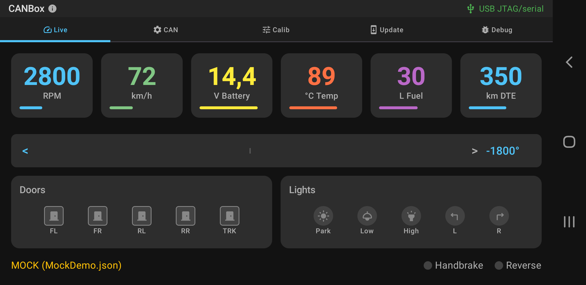
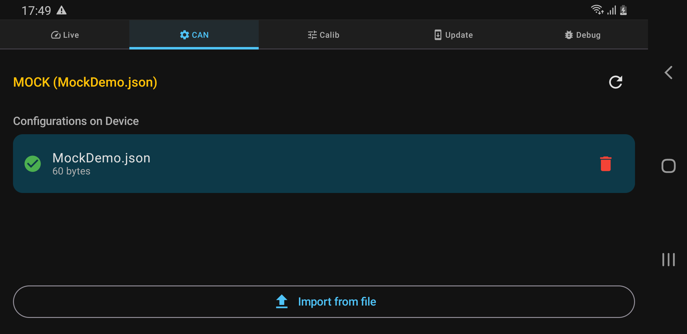
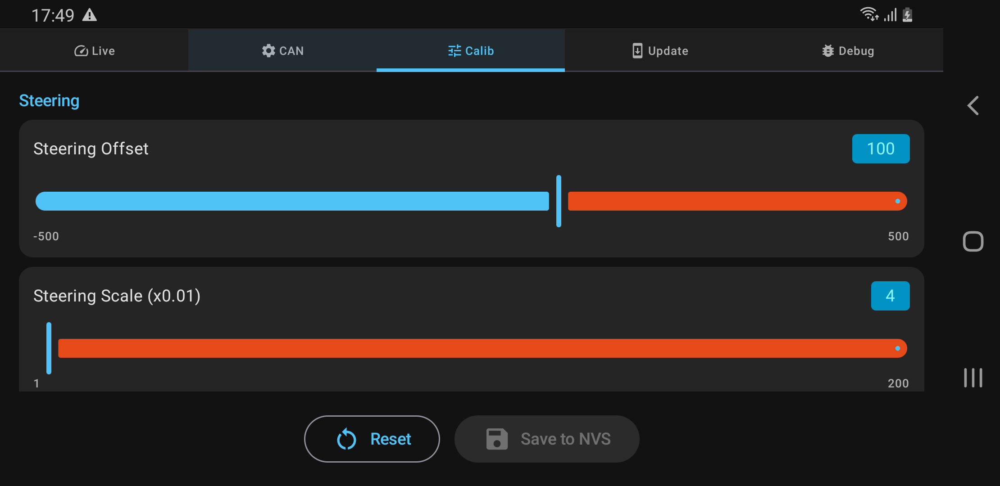
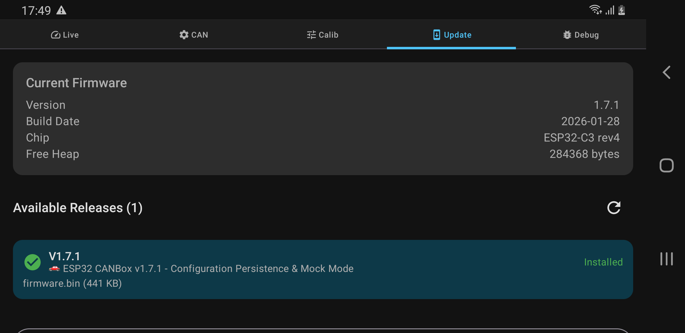

# ESP32 CANBox Manager

> [!WARNING]
> **Work in Progress**: This application is currently under active development. Due to limited time for exhaustive testing and completion, you may encounter bugs or unfinished features. Use with caution.

Android companion app for configuring and monitoring the ESP32 CANBox (Nissan Juke F15 CAN bridge).

## Screenshots

| Live Dashboard | CAN Config |
|:-:|:-:|
|  |  |

| Calibration | Firmware Update |
|:-:|:-:|
|  |  |

## Features

- **Live Dashboard** - Real-time vehicle data (RPM, speed, voltage, temperature, fuel, steering angle, doors, lights)
- **CAN Config** - Manage vehicle configuration files on the ESP32
- **Calibration** - Adjust calibration parameters (steering offset/scale, RPM divisor, tank capacity, etc.)
- **Firmware Update** - OTA updates via USB serial with GitHub releases integration
- **Debug Console** - Send commands and view ESP32 responses
- **Background CAN logging** - Foreground USB service keeps capture active when the UI is backgrounded
- **Log export** - Durable temporary/final files with atomic finalization and sharing to an email application
- **Auto Update Check** - Notifies when app or firmware updates are available

## Requirements

- Android device with USB OTG support
- Android 7.0+ (API 24)
- ESP32 CANBox running [esp32-canbox-nissan](https://github.com/aerodomigue/esp32-canbox-nissan) firmware

## Target Device

Optimized for 1280x720 landscape displays (Android head units).

## USB Communication

The app communicates with the ESP32 via USB CDC serial (115200 baud) using AT-style commands:

| Command | Description |
|---------|-------------|
| `SYS INFO` | Get firmware version and system info |
| `SYS DATA` | Get live vehicle data |
| `CFG LIST/GET/SET/SAVE` | Calibration parameters (NVS) |
| `CAN STATUS/LIST/LOAD/DELETE` | Vehicle config files (LittleFS) |
| `LOG ON/OFF` | CAN frame debug logging |
| `OTA START/DATA/END` | Firmware update (base64) |

## Building

```bash
# Clone
git clone https://github.com/aerodomigue/esp32-canbox-manager.git
cd esp32-canbox-manager

# Build debug APK
./gradlew assembleDebug

# APK location
app/build/outputs/apk/debug/app-debug.apk
```

The repository includes the Gradle wrapper. Configure `local.properties` with
the local Android SDK path (for example `sdk.dir=/opt/android-sdk`); this file
is intentionally ignored by Git.

CAN logs are stored in the app-specific external directory under
`Documents/canbox/`. The active session is written to `canlog_tmp.txt`, and
the Save action creates an atomic timestamped local snapshot. If a USB drive
or SD card is mounted, Save also copies the entire snapshot to
`<external volume>/CANBox/logs/`, without
a destination picker. The copy does not parse or filter lines, is not limited
to the 200 displayed entries, and preserves every byte (including RX/ODB lines
and their original line endings). A `.part` file is synced and its SHA-256
verified before finalization. The local snapshot is kept on success or failure.
The email action always shares the local snapshot through `FileProvider`.

On Android 11+ (including Android 13+), direct USB/SD export needs the initial
system **All files access** grant. Save opens this setting when needed and
resumes the copy on return if granted; it never opens a folder picker. No mounted
external volume means local save only. Older Android versions retain local save/email.
This permission is intended for the sideloaded head-unit build, not an assumed
Google Play policy exemption.

Both SD cards and USB drives are eligible: the destination must be a mounted,
writable, removable, non-primary, non-emulated volume reported by Android.
Internal emulated storage is never treated as an external export destination.
If multiple external volumes are present, stable UUID/path ordering selects one
automatically. The actual destination is displayed after the copy. Removal or
write failure is reported without losing the local snapshot. Validate physical
mounting and permissions on the actual head unit.

## Tech Stack

- Kotlin
- Jetpack Compose + Material Design 3
- Navigation Compose
- Koin (Dependency Injection)
- usb-serial-for-android
- Retrofit (GitHub API)

## License

MIT License - see [LICENSE](LICENSE)

## Author

**aerodomigue** - [GitHub](https://github.com/aerodomigue)

## Related Projects

- [esp32-canbox-nissan](https://github.com/aerodomigue/esp32-canbox-nissan) - ESP32 firmware
